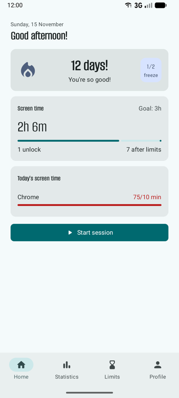
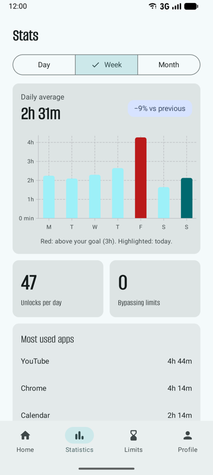
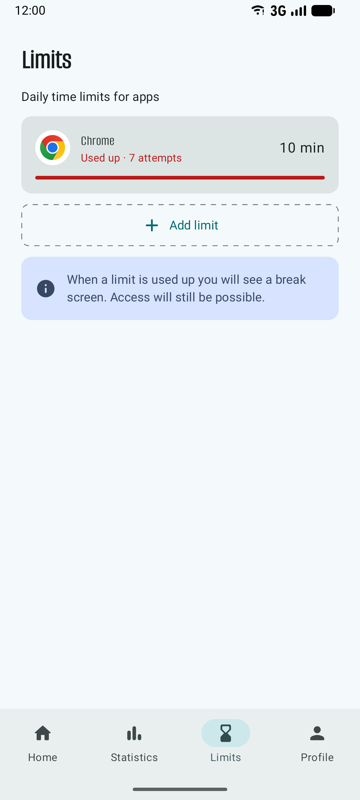
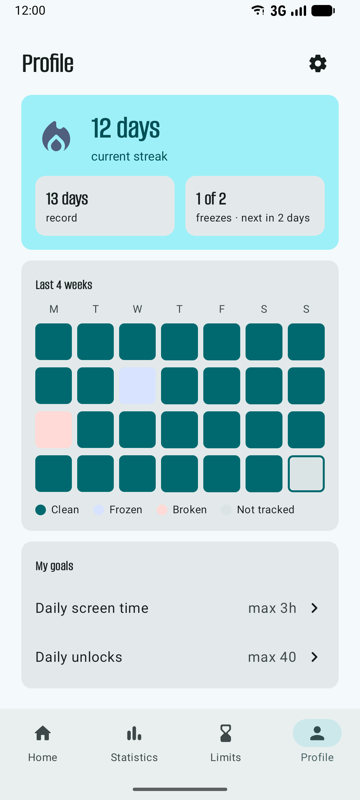
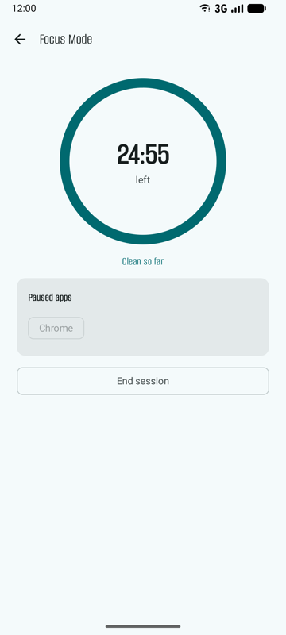
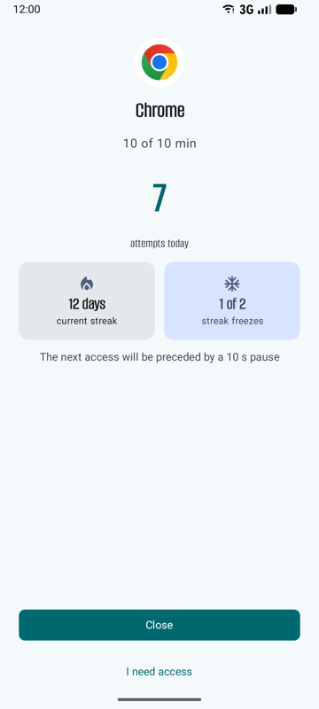
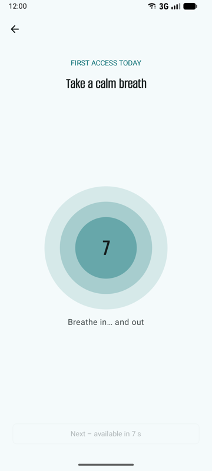
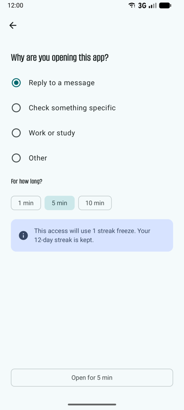

# Pause

An Android app that supports digital balance through awareness, motivation and autonomy. It shows
how much time you spend in apps, lets you set daily limits, and when a limit is used up it adds a
short, calm break instead of blocking: you can always continue after a pause and a stated purpose.
It is the practical part of the engineering thesis *Design and implementation of a mobile app
supporting the user's digital balance*.

All data stays on the device. The app has no internet permission, no accounts and no analytics.

## Screenshots

<table>
  <tr>
    <td align="center"><br>Home</td>
    <td align="center"><br>Statistics</td>
    <td align="center"><br>Limits</td>
    <td align="center"><br>Profile</td>
  </tr>
  <tr>
    <td align="center"><br>Focus Mode</td>
    <td align="center"><br>Break screen: limit used up</td>
    <td align="center"><br>Break screen: pause</td>
    <td align="center"><br>Break screen: purpose and time</td>
  </tr>
</table>

Taken on the API 37 emulator with demo history from the debug tools (see below).

## Features

- **Home** — today's screen time against a goal, unlocks, attempts after limits, top apps, streak.
- **Limits** — daily time limits per app with active weekdays.
- **Break screen** — shown when a limit is used up or a paused app is opened during Focus Mode:
  a breathing pause that grows with every bypass of the day (10 / 30 / 60 s), a purpose and
  1, 5 or 10 minutes of access.
- **Streak** — clean days in a row; a freeze every 7 days (max 2) protects it from one bypass.
- **Statistics** — day, week and month charts, unlocks, limit bypasses, most used apps.
- **Focus Mode** — 15–60 minute sessions during which chosen apps show the break screen.
- **Notifications** — 5 minutes left on a limit, Focus Mode countdown, weekly summary.
- **Settings** — notification switches, permissions, name, delete all data.

## Requirements

- Android 11 (API 30) or newer; built for API 37.
- Android Studio with the Android SDK; JDK 17+ for Gradle.
- On the device: **usage access** (to count time and unlocks) and the **Pause accessibility
  service** (to notice which app is opened; it never reads screen content). Notifications are
  optional.

## Build and test

```
./gradlew assembleDebug                 # build
./gradlew testDebugUnitTest             # JVM unit tests
./gradlew lintDebug                     # lint
ANDROID_SERIAL=<emulator-serial> ./gradlew connectedDebugAndroidTest   # instrumented tests
```

`connectedDebugAndroidTest` installs on every connected device unless `ANDROID_SERIAL` names one;
run it on an emulator (for example an API 37 AVD).

## Architecture

Clean Architecture in one module with MVI screens:

```
presentation  →  domain  ←  data
```

- `domain` — models, repository interfaces, use cases and the pure rules that carry the thesis:
  `UsageEventAggregator`, `FrictionPolicy`, `StreakCalculator`, `DayTracking`,
  `StatisticsCalculator`. It uses only Kotlin, `kotlinx.coroutines`, `java.time` and
  `javax.inject`.
- `data` — Room database (schema in `app/schemas`), DataStore settings, `UsageStatsManager`
  and package manager access, WorkManager workers.
- `service` — `PauseAccessibilityService` and `EnforcementController`, which decides when the
  break screen appears.
- `presentation` — Jetpack Compose screens; each has a `Contract` (state, intents, effects),
  a `ViewModel` and a stateless `Screen`.
- `notification` — channels and the notification helper.

Dependency injection uses Hilt. Time always comes from an injected `java.time.Clock`, so day
boundaries and timers are unit-tested with a virtual clock.

## Debug tools

Debug builds contain a tools screen (long-press the app icon → *Seed demo history*, or
`adb shell am start -n com.justantis.pause/.debug.DebugToolsActivity`) that writes five weeks of
demo history and can post the weekly summary at once. Release builds contain neither.

## Documentation

`docs/IMPLEMENTATION_NOTES.md` lists what was built per phase, every decision and deviation from
the specification, where the assumptions are encoded, what was verified on which device, and known
limitations.
